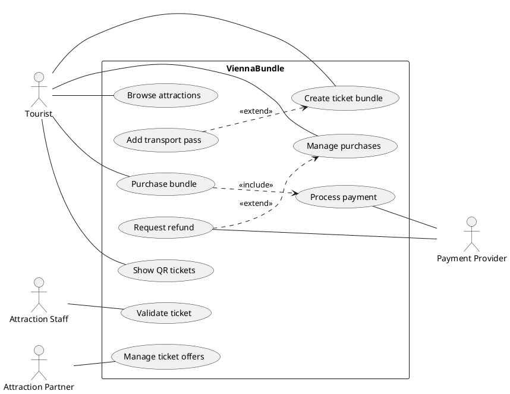

# HostCraft SRS

*Dario Stromajer, Djordje Jovanovic, Daris Murselovic, Andrei Berari - Gruppe 9*
## Goal of the App

When you visit Vienna as a tourist, you end up buying tickets everywhere: one for Schönbrunn, one for the Albertina, one for the Prater, a day pass for the Wiener Linien… Every place has its own website or ticket counter, you stand in a lot of queues and you carry around a pile of paper or PDFs.

ViennaBundle fixes that. You pick the attractions you want to visit, put them together into one bundle (plus a public transport pass if you want), pay once and get all your tickets as QR codes in the app. At the entrance you just show the QR code. The tickets also work offline, so bad signal in the U-Bahn is no problem.

Who uses the app:

- **Tourist** – buys and uses the tickets
- **Attraction Staff** – scans the QR codes at the entrance
- **Attraction Partner** – the museum, palace or other attraction that sells its tickets through the app
- **Payment Provider** – external system that handles the payments

## Functional Requirements

### Must-criteria

- The app shall provide the tourist with the ability to browse a list of Vienna attractions with prices and opening hours.
- The app shall provide the tourist with the ability to put tickets for several attractions together into one bundle.
- As soon as the tourist changes the bundle, the app shall update the total price of the bundle.
- The app shall provide the tourist with the ability to pay for the whole bundle in one payment.
- The app shall be able to send payment data to the payment provider and receive the payment confirmation.
- As soon as the payment is confirmed, the app shall create a QR code for every ticket in the bundle.
- The app shall provide the tourist with the ability to show their QR tickets.
- The app shall provide the tourist with the ability to see all their purchases.
- The app shall provide the attraction staff with the ability to scan and validate QR tickets.
- If a scanned ticket was already used or is for a different attraction or date, the app shall show the attraction staff an error message.
- The app shall provide the attraction partner with the ability to add, change and remove their ticket offers.

### Should-criteria

- The app should provide the tourist with the ability to search attractions by name or category (museum, palace, park…).
- The app should provide the tourist with the ability to add a Wiener Linien pass (24h, 48h or 72h) to the bundle.
- If an attraction uses time slots, the app should provide the tourist with the ability to select a time slot.
- The app should provide the tourist with the ability to save their tickets on the phone for offline use.
- If the visit is at least 24 hours away, the app should provide the tourist with the ability to request a refund for an unused ticket.

### Could-criteria

- If a bundle contains 3 or more attractions, the app will give the tourist a discount on the total price.
- 2 hours before a booked time slot, the app will send the tourist a reminder.
- The app will provide the tourist with the ability to switch the app language (German, English, Italian, Spanish, French).
- The app will provide the tourist with the ability to add their tickets to Apple Wallet or Google Wallet.

### Won't-criteria

- The app will not provide the tourist with the ability to book hotels or flights.
- The app will not provide the tourist with the ability to resell or transfer tickets to other users.
- The app will not provide the tourist with the ability to reserve tables in restaurants.

## Non-Functional Requirements

### Speed

- The app shall show the attraction list within 2 seconds after the tourist opens it.
- As soon as the attraction staff scans a QR code, the app shall show whether the ticket is valid within 1 second.
- The app should finish a payment (from tapping "Pay" to showing the QR codes) within 10 seconds.

### Ease of Use

- The app should provide a first-time tourist with the ability to buy a bundle within 5 minutes without any help.
- The app should explain the basic features in a tutorial with no more than 5 screens.

### Reliability

- The app's ticket shop shall be available at least 99.5% of the time.
- The app should run on average at least 200 hours without crashing (mean time to failure).

### Robustness

- If the app crashes during a payment, the app shall not charge the tourist twice.
- As long as the phone has no internet connection, the app should show saved QR tickets within 1 second.

## Use Case Diagram

## Use Case Descriptions

| Use case | Browse attractions |
|---|---|
| Actors | Tourist |
| Description | The tourist looks through the attractions in the app to decide what to visit. |
| Stimulus | The tourist opens the "Attractions" tab. |
| Response | 1. The app shows a list of all attractions with picture, price and opening hours. 2. The tourist scrolls, or searches by name or category. 3. The tourist taps an attraction. 4. The app shows the details (description, prices, address, time slots if there are any). |
| Comments | Categories could be museums, palaces, parks, Prater etc. |

| Use case | Create ticket bundle |
|---|---|
| Actors | Tourist |
| Description | The tourist picks some attractions and puts their tickets into one bundle, so they can buy everything at once. |
| Stimulus | The tourist taps "Add to bundle" on an attraction. |
| Response | 1. The app adds the ticket to the bundle and shows the bundle. 2. The tourist picks the date (and a time slot, if the attraction has them) and the number of people (adults, kids, students). 3. The app updates the total price. 4. The tourist adds more attractions or goes to checkout. |
| Comments | Can be extended by "Add transport pass". |

| Use case | Add transport pass |
|---|---|
| Actors | Tourist |
| Description | The tourist adds a Wiener Linien pass to the bundle, so public transport is covered too. |
| Stimulus | The tourist taps "Add transport pass" in the bundle. |
| Response | 1. The app shows the passes (24h, 48h, 72h) with their prices. 2. The tourist picks a pass and the start date. 3. The app adds the pass to the bundle and updates the total price. |
| Comments | Extends "Create ticket bundle". Optional, not every tourist needs public transport. |

| Use case | Purchase bundle |
|---|---|
| Actors | Tourist, Payment Provider |
| Description | The tourist pays for the whole bundle in one go and gets all tickets. |
| Stimulus | The tourist taps "Checkout" in the bundle. |
| Response | 1. The app shows a summary of all tickets and the total price. 2. The tourist confirms and enters the payment details. 3. The app sends the payment to the payment provider (includes "Process payment"). 4. The payment provider confirms the payment. 5. The app creates a QR code for every ticket and sends a confirmation email. |
| Comments | If the payment fails, the bundle stays saved and the tourist can try again. Card data is only handled by the payment provider. |

| Use case | Process payment |
|---|---|
| Actors | Payment Provider |
| Description | The app hands the payment over to the payment provider and waits for the result. |
| Stimulus | The tourist confirms the payment during "Purchase bundle". |
| Response | 1. The app sends the amount and payment details to the payment provider. 2. The payment provider charges the card (or PayPal, Apple Pay etc.). 3. The payment provider sends back "successful" or "failed". 4. The app shows the result to the tourist. |
| Comments | Always included in "Purchase bundle". |

| Use case | Show QR tickets |
|---|---|
| Actors | Tourist |
| Description | The tourist opens their tickets to show them at the entrance. |
| Stimulus | The tourist opens "My tickets". |
| Response | 1. The app shows all valid tickets, sorted by date. 2. The tourist taps a ticket. 3. The app shows the QR code in full screen with maximum brightness. |
| Comments | If the tourist saved the tickets for offline use, this also works without signal. |

| Use case | Manage purchases |
|---|---|
| Actors | Tourist |
| Description | The tourist looks at all their past and upcoming purchases. |
| Stimulus | The tourist opens "My purchases". |
| Response | 1. The app shows all purchases, newest first. 2. The tourist taps a purchase. 3. The app shows the details (tickets, price, date, payment status). |
| Comments | Can be extended by "Request refund". |

| Use case | Request refund |
|---|---|
| Actors | Tourist, Payment Provider |
| Description | The tourist gets their money back for a ticket they can't use. |
| Stimulus | The tourist opens a purchase in "My purchases" and taps "Request refund". |
| Response | 1. The app checks that the ticket is unused and the visit is at least 24 hours away. 2. The app shows the refund amount. 3. The tourist confirms. 4. The app sends the refund to the payment provider and cancels the QR code. |
| Comments | Extends "Manage purchases". Not possible for used tickets or less than 24 hours before the visit. |

| Use case | Validate ticket |
|---|---|
| Actors | Attraction Staff |
| Description | The staff at the entrance checks if a ticket is valid. |
| Stimulus | The tourist shows the QR code and the staff scans it. |
| Response | 1. The app reads the QR code. 2. The app checks that the ticket is for this attraction, for today, and not used yet. 3. The app shows green (valid) or red (invalid, with the reason). 4. If the ticket is valid, the app marks it as used. |
| Comments | The staff use the same app with a staff login. |

| Use case | Manage ticket offers |
|---|---|
| Actors | Attraction Partner |
| Description | The attraction partner keeps their tickets in the app up to date. |
| Stimulus | The partner logs in and opens "My offers". |
| Response | 1. The app shows all ticket offers of this attraction. 2. The partner adds a new offer, or changes or removes an existing one (price, opening hours, time slots). 3. The app saves the changes and shows them to tourists right away. |
| Comments | A partner can only change the offers of their own attraction. |
